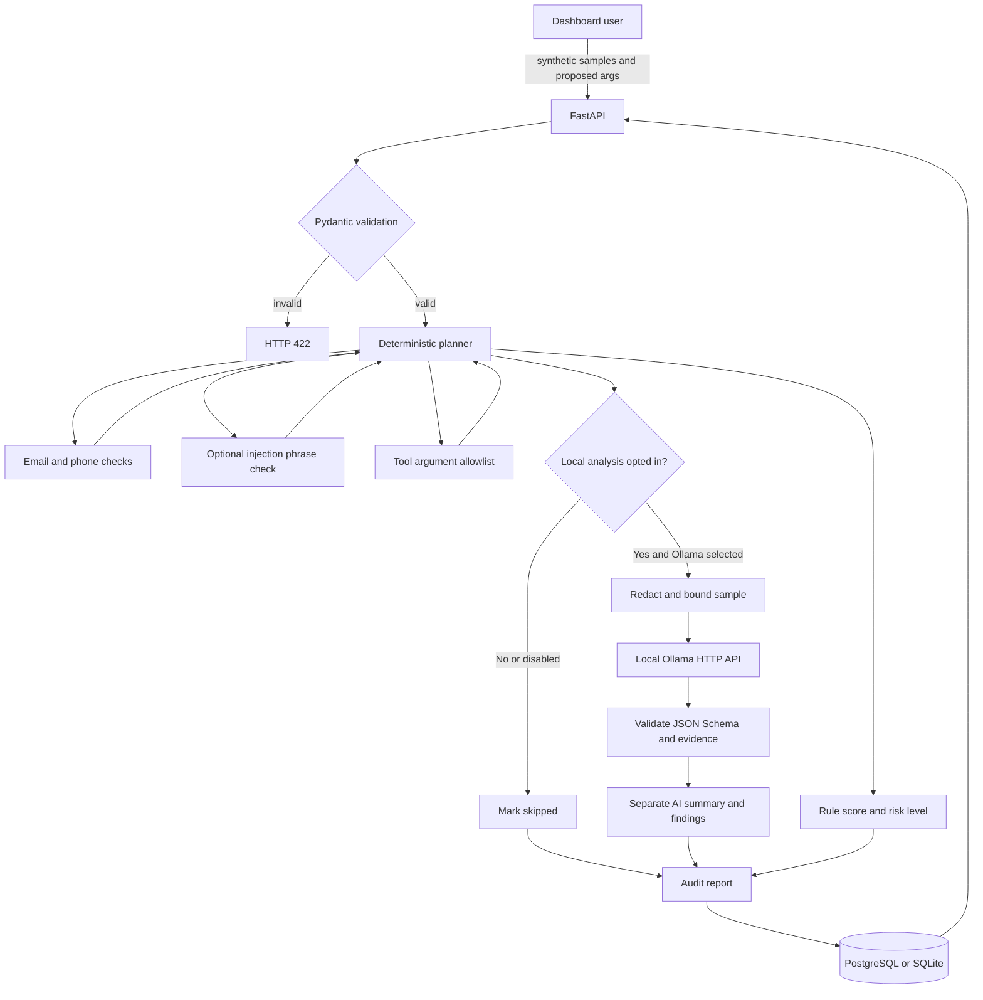

# Architecture and request flow

This document describes the HTTP app and local Ollama integration. Deterministic checks and scoring remain authoritative; the model assessment is optional, separate, and never executes tools.

## Components

- **Dashboard (`app/static/index.html`)** collects audit samples and proposed tool arguments, displays rule and AI results separately, loads persisted summary metadata, and exports selected reports. It discloses local sample processing before the opt-in control.
- **FastAPI (`app/main.py`)** validates audit requests and serves health, readiness, status, privacy-minimized history summaries, full audit history, report, and export routes.
- **Planner (`app/agent.py`)** runs deterministic scanner functions, builds traces and score contributions, and optionally invokes the configured local AI provider.
- **Rule tools (`app/tools.py`)** perform email/phone heuristics, phrase-based injection checks, and argument allowlist validation.
- **Ollama adapter (`app/ollama.py`)** sends only opted-in, bounded and best-effort-redacted sample outputs to `POST /api/chat` on a local host address. It requests JSON Schema output, validates the response and evidence against the redacted sample, and maps transport/validation errors to safe categories. A JSON, schema, or evidence validation failure may receive one correction attempt; transport failures are not retried.
- **Schemas (`app/schemas.py`)** define requests, rule findings, separate AI findings, audit reports, and history pages. `run_gemini_analysis` is accepted as a legacy opt-in alias; it cannot select or call Gemini.
- **SQLAlchemy and Alembic (`app/database.py`, `app/models.py`, `migrations/`)** persist completed reports, with PostgreSQL and a named data volume in Compose.

The persisted `ai_analysis` field and JSON database column are provider-neutral. The migration that introduced this column retains its historical Gemini filename/revision and must remain in the Alembic chain. `AIAnalysis` accepts the historical `provider="gemini"` value so older saved reports remain readable. The API also retains inert Gemini-named request/status compatibility fields; none can select a cloud provider.
- **MCP (`mcp_server.py`)** exposes the deterministic helper functions over stdio independently from the HTTP app.

The MCP wrappers enforce the same 100-sample, 8,000-character per-sample, 64,000-character combined sample, and 16,000-byte argument limits as the HTTP schema. The argument tool also caps the number of entries at 50.

The runtime provider factory supports only `AI_PROVIDER=ollama` or disabled analysis. It rejects non-local Ollama hostnames and model names tagged `-cloud` or `:cloud`. Compose passes only the local endpoint/model configuration; the project does not require a cloud AI SDK.

## HTTP flow

`run_ai_analysis` is the current opt-in field. The former `run_gemini_analysis` request field remains accepted as an alias so older clients still opt into the selected local provider. No API request field can select a cloud provider.

On page load and after each saved audit, the dashboard requests `GET /api/audits/summary` for the real record total and recent metadata. This response omits report findings and evidence. Selecting a history item fetches its full report from `GET /api/audits/{audit_id}`; downloading uses the existing schema-validating export route. An empty database displays an explicit empty state, and failed history requests display an error state rather than invented records.

## Trust boundaries and validation

1. **Browser to API:** request fields are validated with Pydantic; unknown fields are rejected and sample count/other input bounds are enforced by existing schemas.
2. **Untrusted sample to deterministic checks:** sample text is data only. Heuristics inspect it but do not execute it. Tool arguments are validated and never executed.
3. **Opted-in sample to Ollama:** only `sample_outputs` are passed; descriptions and proposed tool arguments are excluded. Common email, phone, credential, and token patterns are redacted before the 8,000-character serialized-input limit is checked. This is incomplete pattern-based minimization, not anonymization or a privacy guarantee. The URL is limited to `localhost`, loopback addresses, or Docker Desktop's `host.docker.internal` over HTTP. Cloud-tagged models are rejected. Use a locally installed model and synthetic content.
4. **Ollama response:** JSON Schema formatting is requested through the Ollama `format` field, then Pydantic validates returned content. Evidence must occur in the redacted sample. Output is untrusted text; no instructions, commands, or model tool calls are executed.
5. **Risk score:** only deterministic rule findings contribute points. AI findings remain under `ai_analysis` and cannot affect risk score or severity contributions.
6. **Database:** audit reports can contain evidence snippets. Compose persists PostgreSQL data in `postgres_data`; migrations run before the API. Do not remove that volume unless intentionally deleting stored audit history.

## Failure handling

- Invalid request bodies return HTTP 422.
- `/health` checks API liveness; `/ready` checks database access and returns HTTP 503 if it is unavailable.
- Database failures return generic service-unavailable messages without connection details.
- An Ollama timeout, unavailable service, HTTP error, malformed JSON, invalid schema, or unsupported evidence results in a sanitized AI status. Deterministic findings and score are returned and persisted normally.
- The dashboard renders trace entries as separate rows using text-only DOM updates, readable tool labels, status badges, durations, and summaries. AI failure categories are translated into user-facing messages while rule findings remain visible.
- When AI is disabled or not requested, the response reports `skipped` without fabricating a summary or findings.
- PostgreSQL schema changes use Alembic migrations rather than creating production tables on API startup.

## Privacy and limitations

Ollama runs on the host at `http://host.docker.internal:11434` when called from the API container. The application limits configured URLs to local addresses and rejects model tags marked as cloud-hosted. This does not inspect arbitrary Ollama Modelfiles or guarantee how a locally configured Ollama installation behaves. Samples are sent to the local Ollama process only when a user opts in. Do not submit real personal, confidential, or credential data. Regex checks can miss sensitive text; model output can be wrong or inconsistent; neither the deterministic checks nor local model results establish formal privacy/security compliance or production guarantees.
