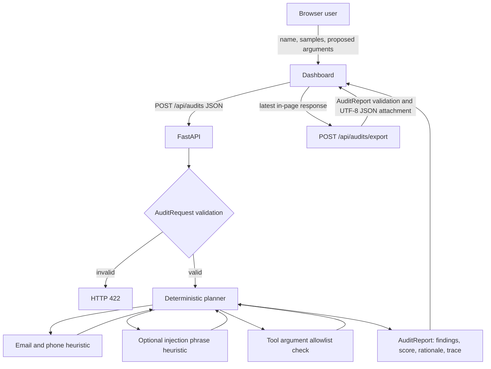
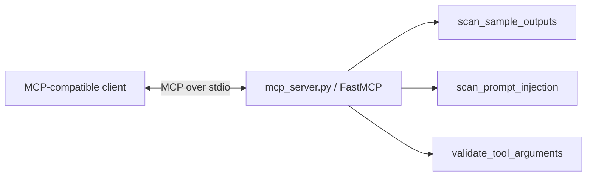

# Architecture and request flow

This document describes the implementation in `app/` and `mcp_server.py`. The project is a local educational prototype: its agent is a deterministic orchestration function, not an LLM planner.

## Components

- **Static dashboard (`app/static/index.html`)** collects a name, sample outputs, and proposed tool arguments. It calls the HTTP API, renders the result using DOM text nodes, keeps the latest successful response in page memory, and sends that response to the export route on download.
- **FastAPI application (`app/main.py`)** serves the dashboard and health check, validates audit requests, returns audit reports, and validates/serializes report exports.
- **Schemas (`app/schemas.py`)** define `AuditRequest`, `Finding`, `ToolTrace`, and `AuditReport` with Pydantic.
- **Deterministic planner (`app/agent.py`)** runs the bounded checks in sequence, adds finding IDs and point contributions, collects execution traces, computes the score and risk band, and constructs the response.
- **Audit functions (`app/tools.py`)** perform email/phone pattern matching, fixed prompt-injection marker matching, and proposed argument allowlist/bound checks.
- **MCP server (`mcp_server.py`)** registers three FastMCP tools that wrap those same audit functions. It uses stdio transport and is launched independently from FastAPI.

## HTTP audit flow

The export request goes back through FastAPI and Pydantic; it does not re-run the audit. The dashboard's latest report exists only in page memory and is lost on reload.

## MCP flow

The MCP server exposes `scan_outputs`, `scan_injection_signals`, and `check_tool_arguments`. These tools return the helper results directly; they do not create an `AuditReport`, assign aggregate risk, persist data, or call the HTTP server.

## Trust boundaries and validation points

1. **Browser to API:** request JSON is untrusted. `AuditRequest` strips surrounding whitespace from strings, forbids extra request fields, limits `name` to 1–100 characters, `description` to 1,000 characters, and sample count to 100. Pydantic validates field types. The request model does not impose a per-sample string length limit.
2. **Sample content to heuristics:** samples are treated as text. Email and phone matches are evidence candidates; fixed marker phrases indicate possible injection-like text. No sample text is executed or sent to an external service.
3. **Proposed arguments:** only the names `query`, `limit`, `language`, `top_k`, and `document_id` are allowed. String values are bounded at 500 characters; `limit` and `top_k` must be integer values from 1 through 100. These proposed arguments are inspected, not executed.
4. **MCP client to MCP tools:** FastMCP/Pydantic validates tool argument types. The wrappers reject more than 100 output samples or more than 50 argument entries before calling the helper functions.
5. **Dashboard to export route:** the browser sends the last API response as JSON. FastAPI validates it as an `AuditReport` before serializing it to an attachment. Report fields such as evidence and trace are accepted as report data; this route does not recompute whether the report is truthful.

## Failure handling

- Invalid HTTP request bodies or export report objects are rejected by FastAPI/Pydantic with HTTP 422.
- `POST /api/audits` catches an exception escaping `run_audit` and returns a generic HTTP 500 detail (`Audit failed safely.`). It does not expose the exception message in that response.
- The planner wraps each individual tool call. An exception creates a trace entry with status `error` and a summary containing the exception type; remaining checks continue. The report's risk score is calculated from findings, not tool failures, so a failed check can leave a low score. Inspect the trace when reviewing results.
- The MCP wrappers raise on configured input-count limits; FastMCP returns tool errors for invocation/validation failures.
- The dashboard shows request/export errors in its results area. Export is available only after a successful audit response is received.

## Data handling notes

There is no database or server-side audit history. API responses and downloaded files can contain evidence snippets derived from supplied text. Do not use real personal information, credentials, or confidential content in this educational demo. Regex matching and marker matching are incomplete and can both miss and over-report cases. Neither this architecture nor its score establishes privacy or security compliance.
